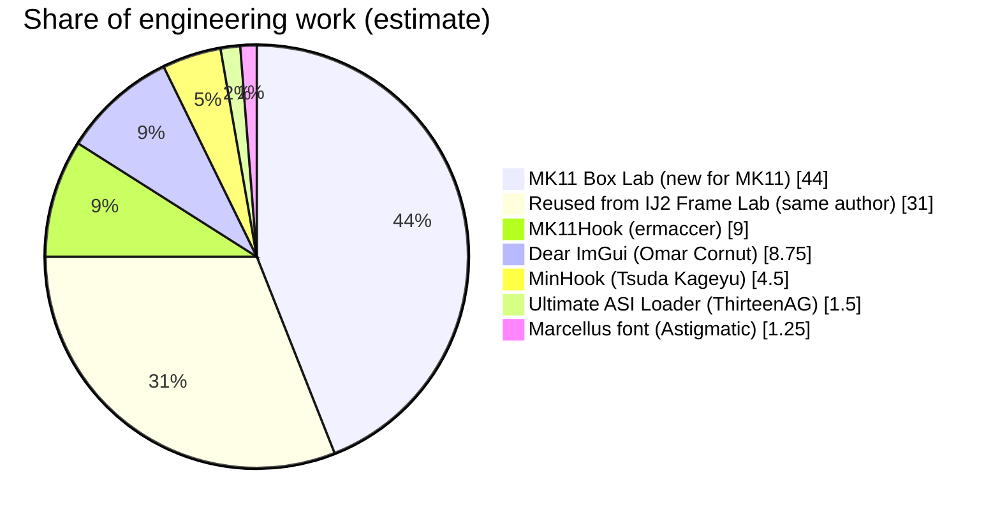

# MK11 Box Lab

Hitboxes and hurtboxes for **Mortal Kombat 11** (PC, Steam) Practice mode.

> **Practice mode only.** The overlay turns itself off in any other game mode. Never use mods online.

Download the ready-to-use build from [Nexus Mods](https://www.nexusmods.com/mortalkombat11/mods/148). This repository is the source code.

## Features

- Hitboxes drawn exactly where the game's own hit test checks them, on the frames they are live: strike spheres for punches and kicks, weapon shapes (Kabal's hookswords, Sub-Zero's axe) and projectiles.
- Hurtboxes: the body spheres each fighter can be hit on.
- MK11 tests hits in 2D, along the line between the fighters. Every shape is drawn on that line, so if two shapes touch on screen, the attack hits.
- Hitbox linger, so 1-frame actives stay visible, plus separate opacity sliders and filled or outline drawing.
- Freeze and frame-step, and HDR-safe screenshots.
- A controller-friendly F2 menu styled after the game's pause menu.

### How the hitboxes are read

MK11 attacks are tested in several ways: bone-attached strike spheres, and lists of collision primitives (spheres, capsules and swept shapes) on melee, weapon and projectile collision objects. Capsules are turned into a 2D polygon on the fight plane before they are tested.

MK11 Box Lab hooks the game's per-primitive hit test and each sub-test it runs: 2D and 3D spheres, 2D and 3D capsules. It records exactly the shapes and sizes the game tested on that frame. For capsules it calls the game's own polygon builder. The overlay therefore draws what the game tested, not a re-creation. This was checked by logging the gap between the drawn shapes and the opponent's hurtboxes on every tested frame: every hit had the shapes overlapping and every whiff had a gap.

## Building

Requirements: CMake 3.16+ and a 64-bit C++17 compiler.

- **MinGW-w64** (the toolchain the releases are built with), cross-compiling from Linux:
  ```
  cmake -B build -DCMAKE_TOOLCHAIN_FILE=cmake/mingw-w64-x86_64.cmake -DCMAKE_BUILD_TYPE=Release
  cmake --build build -j
  ```
- **Visual Studio 2022** (x64) should also work but hasn't been tested yet:
  ```
  cmake -B build -A x64
  cmake --build build --config Release
  ```

The build produces two files:

| File | What it is |
|---|---|
| `MK11BoxLab.asi` | A small loader picked up by [Ultimate ASI Loader](https://github.com/ThirteenAG/Ultimate-ASI-Loader). |
| `MK11BoxLab_core.dll` | The mod itself. The loader can hot-reload it (Ctrl+F5) without restarting the game. |

Copy both, plus `dist/MK11BoxLab.ini`, into `Mortal Kombat 11\Binaries\Retail`.

## Source layout

| File | Purpose |
|---|---|
| `src/loader.cpp` | The `.asi` loader and hot reload |
| `src/dllmain.cpp` | DX11 Present hook, ImGui setup and theme, window/input hooks |
| `src/mk11.cpp` | Game integration: players, hurt and strike spheres, collision objects and their primitives, hit-test capture, the fight plane, game mode, freeze/step |
| `src/boxes.cpp` | Hitbox and hurtbox drawing, linger |
| `src/ui.cpp` | F2 menu, quick-reference card, advanced window |
| `src/buffer.cpp` | XInput hook: menu input capture |
| `src/dinput_block.cpp` | Blocks keyboard input to the game while the menu is open |
| `src/screenshot.cpp` | Back-buffer PNG screenshots |
| `src/bot.cpp`, `src/trace.cpp`, `src/probe.cpp` | Scripted test input, hardware data-breakpoint traces and function probes (command file), practice mode only |
| `src/font_marcellus.h` | The Marcellus font, embedded for the menus |
| `src/game.cpp`, `src/movelist.cpp` | Frame data code carried over from IJ2 Frame Lab. Compiled, but not used by MK11 Box Lab yet. |

## Third-party code and credits

| Credit | Project | How MK11 Box Lab uses it | Licence |
|---|---|---|---|
| [ermaccer](https://github.com/ermaccer) | [MK11Hook](https://github.com/ermaccer/MK11Hook) | The function signatures for the game's core systems (game tick, GameInfo, player and object lookup, positions, bones, camera, game speed) and the freeze-world hook behind freeze / frame-step, in `src/mk11.cpp`. | - |
| [ThirteenAG](https://github.com/ThirteenAG) | [Ultimate ASI Loader](https://github.com/ThirteenAG/Ultimate-ASI-Loader) | Loads the mod into the game. Required, but not included. | MIT |
| [Omar Cornut](https://github.com/ocornut) | [Dear ImGui](https://github.com/ocornut/imgui) | The overlay UI: menus, drawing. Included in `external/imgui`. | MIT |
| [Tsuda Kageyu](https://github.com/TsudaKageyu) | [MinHook](https://github.com/TsudaKageyu/minhook) | Hooks the game's rendering, input and hit-test functions. Included in `external/minhook`. | BSD 2-clause |
| Astigmatic (Brian J. Bonislawsky) | [Marcellus](https://fonts.google.com/specimen/Marcellus) | The menu font, embedded in `src/font_marcellus.h`. Licence in `dist/OFL-Marcellus.txt`. | SIL OFL 1.1 |

The licences of the included libraries are in their folders.

MK11 Box Lab is a follow-up to [IJ2 Frame Lab](https://github.com/Pluralmite/IJ2FrameLab) by the same author. It started as a copy of that project's code base.

## Contributions

How much of MK11 Box Lab is original work, and how much comes from the projects it builds on. The pie chart is an **estimate** of engineering work by area, not a measurement. The [line counts](#lines-of-code) further down are measured.

MK11 Box Lab's own share is split in two:
- Code reused from IJ2 Frame Lab, the earlier project by the same author.
- New work for MK11.

Both were built by Pluralmite with Claude, as described in [AI usage](#ai-usage).



### How the estimate was made

The mod was split into four areas, each weighted by how much of the work it represents. Each area was then divided between the new MK11 work, code reused from IJ2 Frame Lab, and the projects it uses.

| Area | Weight | From other projects | Reused from IJ2 Frame Lab | New for MK11 |
|---|---|---|---|---|
| Game integration and hit-test research: finding the game's functions and data, the collision objects and primitives, the hit-test functions and the fight plane | 45% | MK11Hook 9% | 9% | 27% |
| Overlay UI: F2 menu, quick-reference card, hitbox / hurtbox drawing, screenshots | 25% | Dear ImGui 8.75%, Marcellus 1.25% | 7% | 8% |
| Testing tools: scripted input, traces, probes, auto-screenshots, hit-gap logging | 15% | None | 6% | 9% |
| Hooking, input and loading: hooks, menu input capture, keyboard block, hot reload | 15% | MinHook 4.5%, Ultimate ASI Loader 1.5% | 9% | 0% |
| **Total** | **100%** | **25%** | **31%** | **44%** |

### Each project

**MK11 Box Lab, new for MK11 (about 44%)**
- The hitbox research in `src/mk11.cpp`. It covers:
  - Finding the collision classes through their vtables.
  - Melee and weapon collision objects and their primitive lists.
  - The per-primitive hit test and its sub-tests.
  - The game's capsule-to-polygon builder and the fight plane.
  - Hurt and strike sphere containers.
  - The practice-mode check and the frame counter.
- Hooking the game's hit test to record exactly what it tested each frame.
- The MK11-styled F2 menu and quick-reference card, polygon drawing and hitbox linger.
- New test tools: auto-screenshots on active frames, hit-gap logging, generic hardware traces and function probes.

**Reused from IJ2 Frame Lab (about 31%)**
- MK11 Box Lab started as a copy of IJ2 Frame Lab, which uses the same NetherRealm engine. Reused unchanged or adapted:
  - The loader and hot reload.
  - The DirectX 11 / ImGui overlay setup.
  - Input capture and the keyboard block.
  - Screenshots.
  - Sphere and capsule drawing.
  - The scripted test harness.
  - Much of the game-integration plumbing (object tracking, snapshots, freeze / step).
- Same author, so this is still Pluralmite's own work. It is shown separately to be clear about what was built for MK11.

**MK11Hook by ermaccer (about 9%)**
- 11 of the mod's function signatures are taken from MK11Hook's `plugin/PatternSolver.cpp`. They cover:
  - The game tick (`MKProcDispatch`).
  - GameInfo and player info / object lookup.
  - Object positions, bones and names.
  - Camera position and game speed.
- The freeze-world hook behind F5 / F6 is ported from MK11Hook's `Dispatch_Hook`. The skeleton offset comes from MK11Hook's `MKCharacter::GetSkeleton`.
- These are only about 20 lines, but the rest of the mod depends on them to find the players and run every frame. That is why they are weighted far above their line count: about 20% of the game integration area.

**Dear ImGui by Omar Cornut (about 8.75%)**
- The toolkit every window, menu, slider and shape is drawn with, including its DirectX 11 and Win32 backends.
- Counted as about 35% of the overlay UI area. The menu layout, MK11 styling and box drawing are this project's own code built on top of it.

**MinHook by Tsuda Kageyu (about 4.5%)**
- The library that installs every hook: the game's functions, DirectX Present, XInput and the window procedure.
- Counted as about 30% of the hooking and input area. What each hook does is this project's code.

**Ultimate ASI Loader by ThirteenAG (about 1.5%)**
- Loads `MK11BoxLab.asi` into the game.
- It is not included in the mod, but the mod needs it to run.

**Marcellus font by Astigmatic (about 1.25%)**
- The font used by the menus, chosen because it is close to MK11's own menu font.

### Lines of code

Non-blank source lines compiled into the mod:

| Project | Lines | Share |
|---|---|---|
| Dear ImGui | 47,635 | 82.8% |
| MK11 Box Lab | 6,922 | 12.0% |
| &nbsp;&nbsp;of which shared with IJ2 Frame Lab | about 5,600 | |
| &nbsp;&nbsp;of which new or changed for MK11 | about 1,300 | |
| MinHook | 2,949 | 5.1% |
| MK11Hook (signatures and hook, inside `src/mk11.cpp`) | 20 | 0.03% |
| Marcellus font | 46 KB font file, not code | n/a |
| Ultimate ASI Loader | Ships separately | n/a |

The MK11 Box Lab count includes about 1,050 lines of IJ2 Frame Lab frame data code (`src/game.cpp`, `src/movelist.cpp`) that is compiled but not used yet.

Line count favours large general-purpose libraries and undercounts small but essential pieces like the MK11Hook signatures. It also says nothing about the hit-test research, which took most of the new work but fits in a few hundred lines. That is why the chart above uses the weighted estimate instead.

## AI usage

MK11 Box Lab was built with heavy use of AI. Pluralmite came up with the project, directed it and tested it. Claude, Anthropic's AI model, did most of the hands-on work, running as an agent with access to the game folder.

### What Claude did

- **Wrote the code:** ported IJ2 Frame Lab to MK11 and wrote the new MK11 code in `src/`.
- **Found the game data and functions the mod uses:** probed the running game with diagnostic builds and the scripted test harness in `src/bot.cpp`. This used hardware data-breakpoint traces and disassembly of `MK11.exe`, and covers:
  - The collision objects and their primitives.
  - The hit-test functions and the capsule polygon builder.
  - The fight plane.
  - The hurt and strike sphere containers.
  - The practice-mode check.

  The core function signatures came from MK11Hook, as described in [Contributions](#contributions).
- **Tested and fixed:** built test versions, hot-reloaded them into the game, took screenshots on active frames, logged hit gaps and fixed the bugs found. One example is Kabal's back 1, which was drawn in the wrong place until the mod captured shapes at the moment the game tests them.
- **Wrote and published the documentation and release:** this README, the release README and the Nexus description. Claude also packaged the release and set up this repository and the Nexus page.
- **Produced the contributions estimate** above.

### What Pluralmite did

- Came up with the idea and decided what the mod should do.
- Played and tested the builds in-game. Reported what was wrong, such as missing weapon and projectile hitboxes and Kabal's back 1 being off.
- Made the design decisions: hitboxes and hurtboxes only, practice mode only, the MK11 look and the menu placement, and making it open source.
- Reviewed and published the release.

### Accuracy

The shapes the mod shows are not generated by AI. They are read live from the running game, from the same functions the game uses to decide hits. AI wrote the code that reads them, and it was checked against real hits and whiffs.

## Licence

[MIT](LICENSE). Copyright (c) 2026 Pluralmite.
